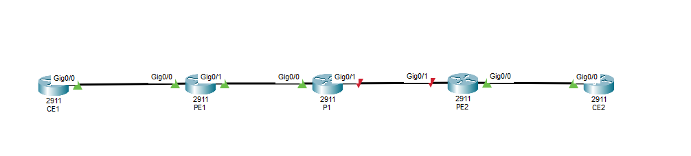
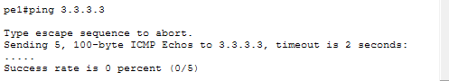
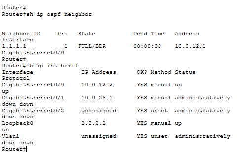
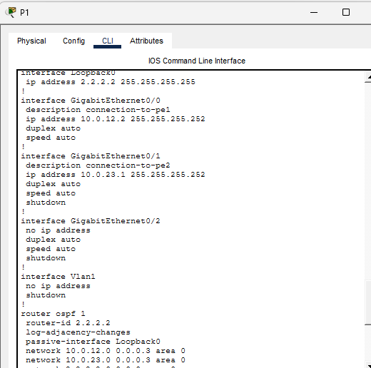
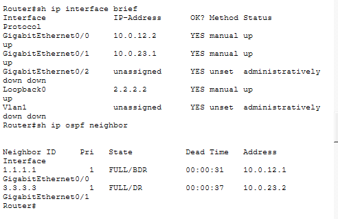
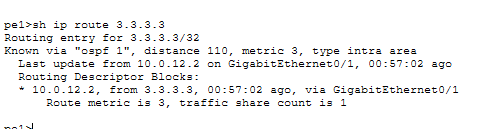
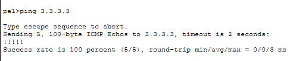

# ISP Network Engineering Lab
### OSPF outage investigation, recovery, and service provider networking study

**Onyekachi Onuoha | Cisco Packet Tracer | Hands-on routing and troubleshooting**

## Why I built this
After my Network Engineer interview, I wanted to act on the technical feedback rather than just review definitions. I built a five-router ISP-style simulation, configured OSPF, intentionally introduced a network fault, and worked through the same troubleshooting approach I would use when investigating a real incident: confirm the symptom, narrow the affected area, check the evidence, correct the cause, and verify recovery.

> **Project scope:** OSPF configuration and outage recovery were demonstrated hands-on in Packet Tracer. MPLS, VRF, and MP-BGP are covered in a separate **conceptual study**, not represented as completed configurations.

## Network topology

`CE1 — PE1 — P1 — PE2 — CE2`

The provider routers **PE1, P1, and PE2** participate in **OSPF Area 0**. The two CE routers represent customer-edge sites.

*Figure 1 — Controlled failure on the provider-core link between P1 and PE2.*

## What I configured and tested
- IPv4 addressing and point-to-point connectivity between adjacent routers.
- OSPF Area 0 across PE1, P1 and PE2, including loopbacks and router IDs.
- OSPF neighbor adjacencies, learned routes, and reachability to remote loopback `3.3.3.3`.
- A controlled failure caused by administratively disabling **P1 GigabitEthernet0/1**.
- Troubleshooting and recovery, with before-and-after evidence.

## Troubleshooting walkthrough

### 1. Confirm the problem
I tested reachability from PE1 to PE2's loopback address, `3.3.3.3`. The ping failed, confirming an actual connectivity problem rather than assuming the link color told the whole story.

*Figure 2 — PE1 cannot reach the remote loopback during the outage.*

### 2. Narrow down where communication stopped
I checked interface status and OSPF neighbors on P1. Its connection toward PE2 was down and its expected PE2 OSPF neighbor was missing. That narrowed the issue to the P1–PE2 segment.

*Figure 3 — Interface status and neighbor information point to the affected link.*

### 3. Identify the cause
I examined the running configuration. The interface had the `shutdown` command, leaving it **administratively down**. This was the deliberate fault introduced for the exercise.

*Figure 4 — The configuration reveals the root cause.*

### 4. Restore the connection and neighbors
After confirming the cause, I re-enabled the interface using `no shutdown`. I then checked interface status and OSPF neighbor relationships rather than assuming the repair was successful.

*Figure 5 — P1 regains its expected OSPF neighbors.*

### 5. Verify the routing table and test again
I confirmed the remote OSPF route was learned again and repeated the ping. The successful responses provided evidence that reachability had been restored.

*Figure 6 — PE1 learns the destination route again.*

*Figure 7 — PE1 reaches `3.3.3.3` successfully after recovery.*

## What this exercise taught me
Troubleshooting is not about entering the first command that comes to mind. I learned to distinguish the **symptom** (failed ping and lost route) from the **cause** (disabled interface), identify how OSPF reacts to the failure, and prove the fix with a repeatable test.

In a production environment, I would also confirm whether a shutdown was part of an approved maintenance or change before restoring an interface.

## Open the actual project and documentation
- **[Download the Cisco Packet Tracer lab (.pkt)](ISP_Network_Engineering_Lab.pkt)**
- **[Read the incident report (PDF)](ISP_Network_Engineering_Incident_Report.pdf)**
- **[Read the MPLS & VRF technical study](documentation/MPLS_VRF_Technical_Study.md)**
- **[See the screenshot evidence checklist](documentation/Screenshot_Evidence_Guide.md)**

All screenshot PNGs can also be opened directly from the repository file list.

## MPLS and VRF: expanding my understanding
I also studied how a service provider connects customers while keeping their routes separated:
- **MPLS:** uses labels to forward traffic through a provider network.
- **VRF:** gives different customers separate routing and forwarding tables.
- **MP-BGP:** exchanges VPN routing information between provider-edge routers.
- **RDs and RTs:** make VPN routes distinct and control import/export policy.

This is **conceptual learning** documented in the [MPLS/VRF study](documentation/MPLS_VRF_Technical_Study.md), not a claim that Packet Tracer ran a full MPLS Layer 3 VPN.

## Recorded demonstration
A narrated walkthrough of this OSPF incident was recorded and shared separately. The recording is not hosted in this repository.

## Next areas of practice
OSPF backup-path behavior and cost adjustment, eBGP configuration, BGP path selection, and MPLS/VRF verification using suitable network emulation software.
